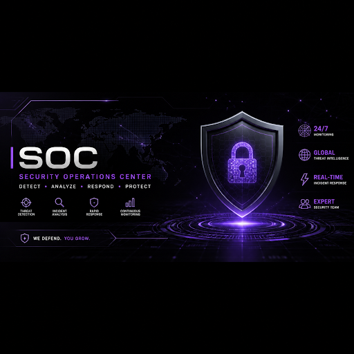
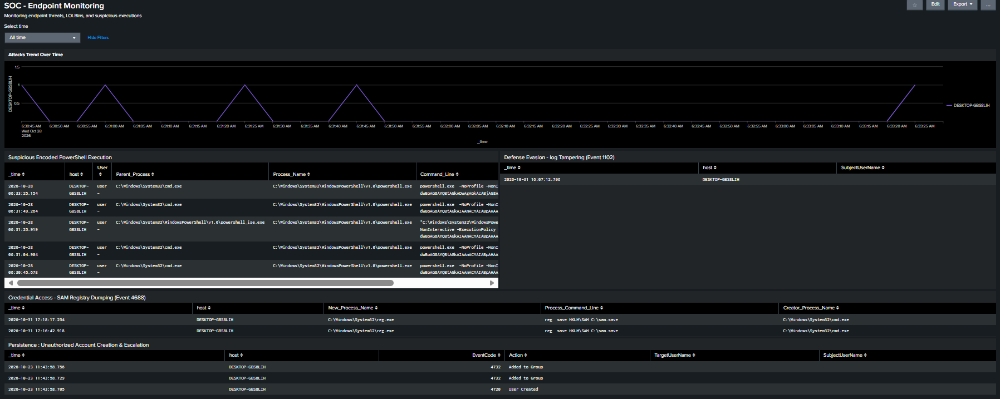

# SOC Tier 1 Home Lab - Endpoint Monitoring



## Overview
This repository documents a home lab built to practice SOC Tier 1 monitoring, log analysis, and alert tuning. The setup collects Windows Security and Sysmon logs using Splunk Universal Forwarder and sends them to a Splunk Enterprise server for threat detection based on the MITRE ATT&CK framework.

## Lab Environment
- SIEM: Splunk Enterprise (Ubuntu Server VM)
- Endpoint: Windows VM (DESKTOP-GBS8LIH) with Universal Forwarder on port 9997
- Data Sources: Windows Security Event Logs (4688, 4720, 4732, 1102) and Sysmon

## Monitoring Dashboard
The dashboard (SOC - Endpoint Monitoring) tracks suspicious command executions, account changes, log clearing, and registry dumping in one view:



## Detection Scenarios

| Scenario | MITRE ID | Event ID | Description |
| :--- | :--- | :--- | :--- |
| Encoded PowerShell | T1059.001 | 4688 | Detects Base64 encoded PowerShell commands |
| Account Persistence | T1136.001 | 4720, 4732 | Tracks local user creation and admin group changes |
| Audit Log Cleared | T1070.001 | 1102 | Alerts when the Windows Security event log is wiped |
| SAM Hive Dumping | T1003.002 | 4688 | Detects attempts to dump SAM or SYSTEM registry hives |

## Alert Tuning (False Positive Reduction)
While monitoring registry activity, normal background checks from U.GG.exe triggered repeated false alerts. The SPL query was updated to exclude this process and focus strictly on reg.exe save commands targeting sensitive hives:

```spl
index=endpoint_logs EventCode=4688 New_Process_Name="*\\reg.exe" (CommandLine="*save*HKLM\\SAM*" OR CommandLine="*save*HKLM\\SYSTEM*") NOT (ParentProcessName="*\\U.GG.exe")
| table _time, host, New_Process_Name, Process_Command_Line, Creator_Process_Name
```

## Author
Omar Said Bashir
