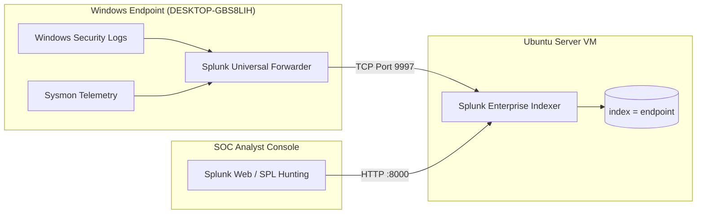
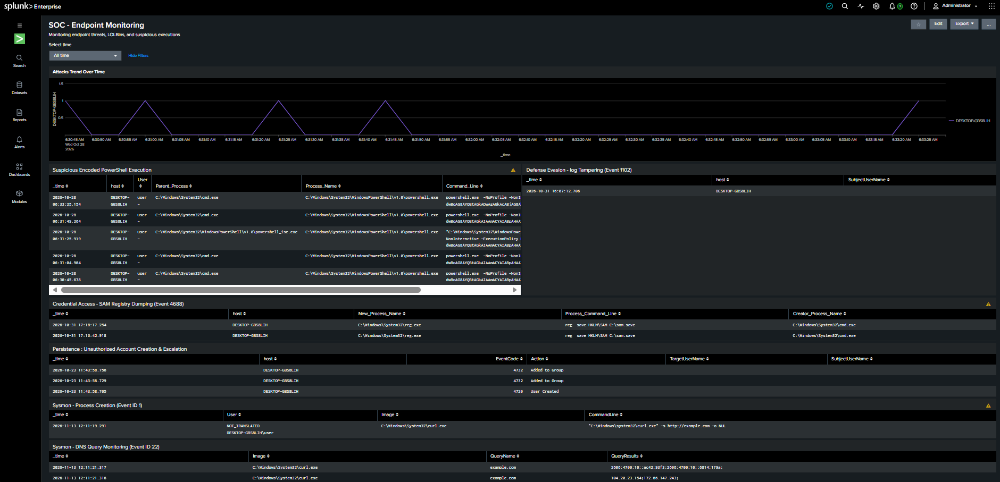

# SOC Tier 1 Home Lab - Endpoint Monitoring


## Overview
This repository documents a home lab built to practice SOC Tier 1 monitoring, log analysis, incident investigation, and alert tuning. The environment collects Windows Security and Sysmon logs using Splunk Universal Forwarder and forwards them to a Splunk Enterprise server for threat detection mapped to the MITRE ATT&CK framework.

## Lab Environment

| Component | Configuration |
| :--- | :--- |
| SIEM Server | Splunk Enterprise on Ubuntu Server VM |
| Monitored Endpoint | Windows Host (`DESKTOP-GBS8LIH`) |
| Log Forwarding | Splunk Universal Forwarder (TCP Port `9997`) |
| Telemetry Sources | Windows Security Logs (`4688`, `4720`, `4732`, `1102`) & Sysmon (`Event ID 1`, `22`) |

## Lab Architecture



## Monitoring Dashboard
The dashboard (`SOC - Endpoint Monitoring`) consolidates suspicious command executions, account persistence, log clearing, registry dumping, and Sysmon process/DNS telemetry in a single view:


## Detection Scenarios

| Scenario | MITRE ID | Event ID | Description |
| :--- | :--- | :--- | :--- |
| Encoded PowerShell | T1059.001 | 4688 (Security) | Detects Base64 encoded PowerShell commands |
| Account Persistence | T1136.001 | 4720, 4732 (Security) | Tracks local user creation and admin group changes |
| Audit Log Cleared | T1070.001 | 1102 (Security) | Alerts when the Windows Security event log is wiped |
| SAM Hive Dumping | T1003.002 | 4688 (Security) | Detects attempts to dump SAM or SYSTEM registry hives |
| LOLBAS Execution | T1105 | 1 (Sysmon) | Tracks suspicious binary execution (`curl.exe`) with full command-line details |
| Outbound DNS Query | T1071.004 | 22 (Sysmon) | Logs external domain resolutions initiated by endpoint processes |

## Incident Investigation Reports
Full Tier 1 investigation documentation including forensic evidence, triage analysis, and tuning recommendations:
- [IR-2026-001: Suspicious Outbound Connection via curl.exe](reports/IR-2026-001-sysmon-lolbas-curl.md)

## Alert Tuning (False Positive Reduction)
While monitoring registry activity, normal background checks from `U.GG.exe` triggered repeated false alerts. The SPL query was refined to exclude this process and focus strictly on `reg.exe save` commands targeting sensitive hives:

```spl
index=endpoint EventCode=4688 New_Process_Name="*\\reg.exe" (Process_Command_Line="*save*HKLM\\SAM*" OR Process_Command_Line="*save*HKLM\\SYSTEM*") NOT (Creator_Process_Name="*\\U.GG.exe")
| table _time, host, New_Process_Name, Process_Command_Line, Creator_Process_Name
```

## Repository Structure
```text
├── configs/
│   └── inputs.conf                           # Splunk Universal Forwarder log collection config
├── queries/
│   └── detection_queries.spl                 # Splunk SPL detection & hunting rules
├── reports/
│   └── IR-2026-001-sysmon-lolbas-curl.md     # Tier 1 incident investigation report
├── Screenshots/
│   └── dashboard .png                        # Full Splunk SOC dashboard view
└── README.md
```

**Author:** Omar Said Taha Bashir
